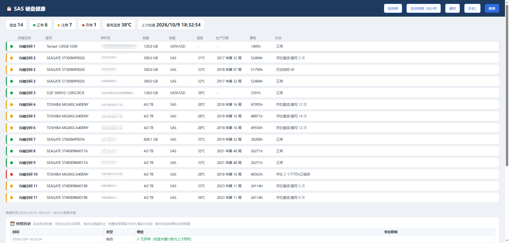
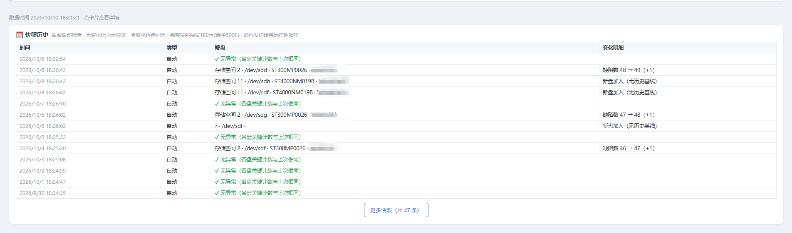
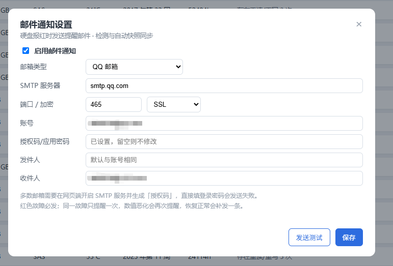
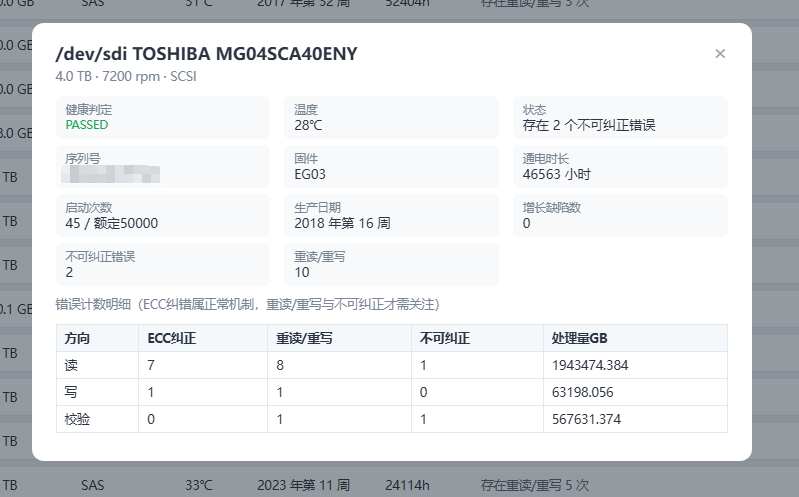
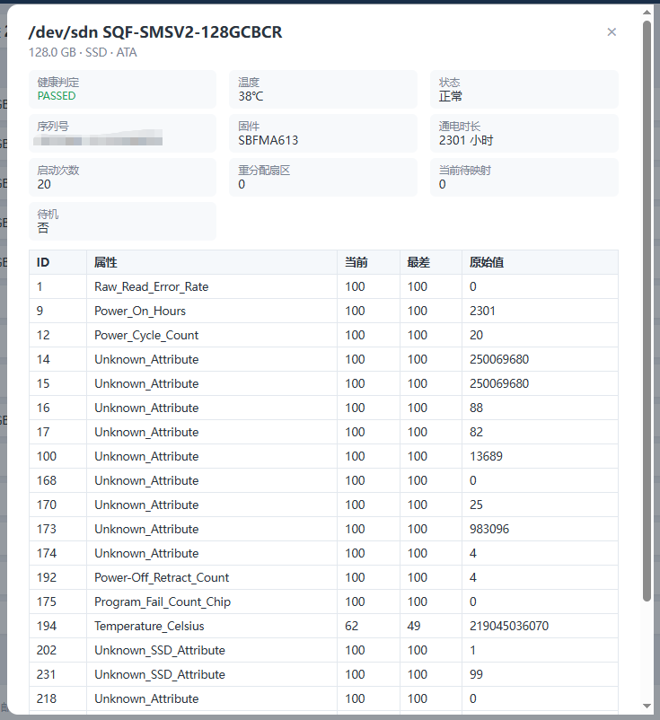

# sashealth - SAS 硬盘健康查看器（飞牛 fnOS 应用）

补齐飞牛 fnOS 不显示 SAS 盘健康的短板：飞牛存储管理器按 ATA 格式解析 SMART，
HBA 直通 / RAID 卡直通的原生 SAS（SCSI 协议）盘解析不出，健康页面空白。
本应用调用系统 smartctl 自己解析，SAS/SATA 双分支，附缺陷增长跟踪与邮件告警。

> 飞牛论坛有对应发帖，欢迎回帖交流；问题反馈请开 Issue，附 `smartctl -a /dev/sdX` 输出更好定位。

## 功能

- **全盘型支持**：SAS/SCSI 与 SATA 双解析分支，HBA 直通、阵列卡透传自动识别
- **LSI RAID 卡**：RAID 模式（OS 看不到物理盘）自动经 `smartctl -d megaraid,N` 直读物理盘，
  H730/H830/9361 等免装 storcli；安装 storcli64 额外显示物理槽位；RAID 虚拟盘自动排除
- **行式列表**：指示灯 / 存储空间 / 型号 / 序列号 / 容量 / 类型 / 温度 / 生产日期 / 通电 / 状态，
  按存储空间编号排序
- **单盘详情**：PASSED/FAILED 判定、固件、序列号、启动次数（含额定）、生产日期，
  SAS 盘含读/写/校验三向错误计数明细（ECC 纠正 / 重读重写 / 不可纠正 / 处理量）
- **健康分级**：红 = SMART 失败 / 不可纠正错误 / 缺陷或重分配增长；黄 = 重读重写 / 历史缺陷；绿 = 正常
- **邮件告警**（v0.10.0+）：硬盘报红自动发邮件。QQ / 163 / 126 / 腾讯企业邮 / Outlook / 自定义 SMTP。
  同一故障只报一次、数值恶化才重报、恢复正常补发"已恢复"；发送失败自动重试，不骚扰不漏报
- **微信推送**（v0.11.0+）：[Server酱](https://sct.ftqq.com/) 推送到微信，邮件与微信双通道可同时启用、互不影响
- **历史快照**：手动 + 后台自动（6h/12h/24h/3天/7天 可选），无变化记"无异常"，
  有变化逐盘列出增量（如 `不可纠正 1 → 2（+1）`）；保留 180 天 / 500 份自动清理

## 截图











## 构建

零依赖，Python 3 标准库：

```bash
python build_fpk.py     # 生成 sashealth_<版本>_x86.fpk
```

离线验证（同样零依赖）：

```bash
python verify_all.py    # 告警状态机 / 邮件构造 单元测试
python check_fpk.py     # fpk 包结构与 manifest 校验
python verify_server.py # 本机起服务做端到端验证（127.0.0.1:7799）
```

## 安装

要求：fnOS x86_64（Debian 12 底座）、系统自带 python3 与 smartmontools
（缺则 `sudo apt install smartmontools`）。查询 SMART 需要 root。

**方式一**：应用中心 → 手动安装 → 选 `.fpk` 文件
（部分 fnOS 版本 UI 可能误报"不是有效的 fpk 文件"，可改用方式二）

**方式二**：上传 fpk 到 NAS，在 NAS 本机以 root 执行：

```bash
sudo python3 install_via_rpc.py
```

装完桌面出现"SAS 硬盘健康"图标，或访问 `http://NAS的IP:7766`。

**升级注意**：飞牛应用中心不支持对已安装应用覆盖安装（会报"应用已安装"），
请先卸载再重装。实测 fnOS 1.2.0800 卸载会保留 @appdata（历史快照与设置都在），
但不同版本行为可能不同，升级前建议先导出/截图快照历史。

## 打包格式备忘

`.fpk` = gzip 压缩的 POSIX USTAR tar，双层均为 gzip；`ui/` 目录必须放进 app.tgz 内部
（安装器只解包 app.tgz，包根的 ui/ 会被丢弃）；root 型应用需 `install_type=root`
且 `config/privilege` 为 `{"defaults":{"run-as":"root"}}`。详见 build_fpk.py。

## 测试环境

Dell R730XD + HBA330 直通，12×SAS（希捷/东芝）+ 2×SATA/SSD，fnOS 1.2.0800

## License

[GPL-3.0](LICENSE)
